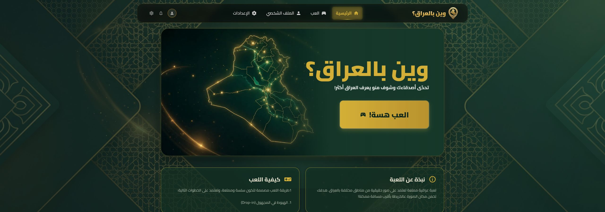

# ⁧وين بالعراق؟⁩

⁧**شكد تعرف العراق؟**⁩

[**⁧▶ العب الآن⁩**](https://wain-bil-iraq.pages.dev/) · [English](README.md)

⁧اكتشف العراق بلعبة تخمين المواقع. ابحث عن الأدلة في المشهد، وحدد تخمينك على الخريطة، ثم اكتشف مدى قربك من المكان الحقيقي.⁩

## ⁧اكتشف اللعبة⁩

- ⁧**عن العراق:** تعرّف إلى مدنه وشوارعه وطبيعته ومعالمه.⁩
- ⁧**راقب الأدلة:** استفد من اللافتات والعمارة والتضاريس لتحديد تخمينك.⁩
- ⁧**اختر على الخريطة:** كبّر الخريطة وضع العلامة في المكان الذي تتوقعه.⁩
- ⁧**اعرف نتيجتك:** قارن تخمينك بالموقع الحقيقي؛ كلما اقتربت زادت نقاطك.⁩

## ⁧طريقة اللعب⁩

1. ⁧افتح [وين بالعراق](https://wain-bil-iraq.pages.dev/) واضغط **العب هسة!**.⁩
2. ⁧تأمل المشهد وحدد تخمينك على الخريطة.⁩
3. ⁧أكد إجابتك، شاهد المسافة والنقاط، وأكمل الجولات.⁩

⁧واجهة اللعبة باللغة العربية. يمكنك اللعب مباشرة من المتصفح مع اتصال بالإنترنت.⁩
